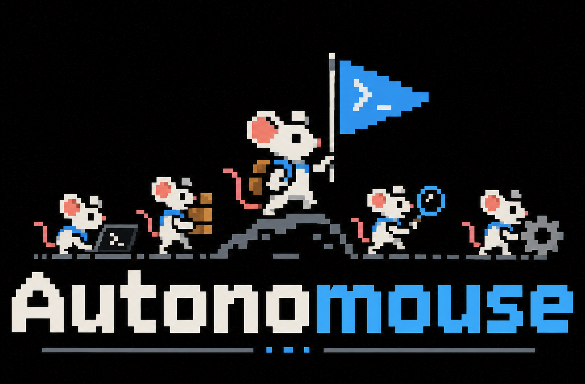
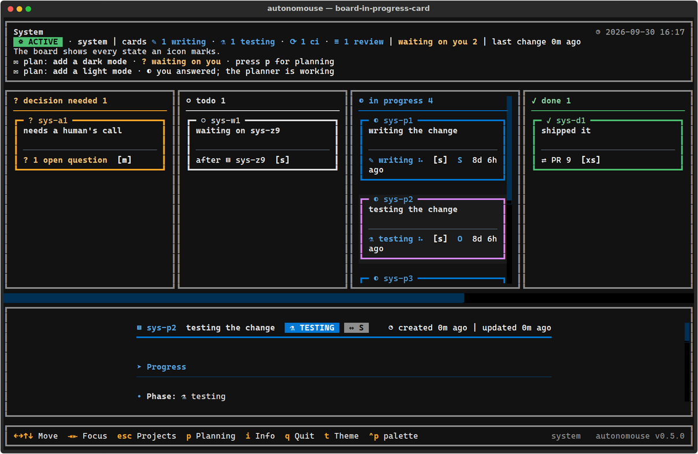
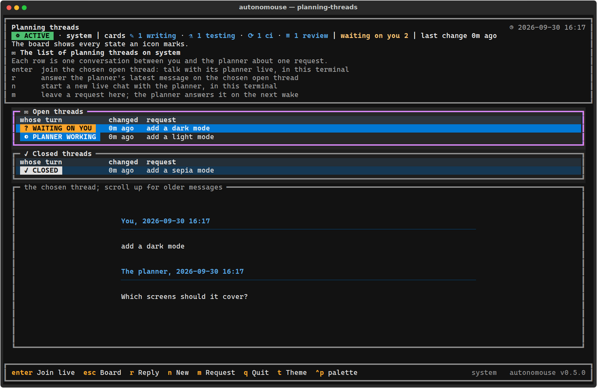

<p align="center">
  
</p>

# autonomouse

autonomouse is a to-do board for autonomous coding sessions. You describe the work. Claude Code
sessions do it while you are away, and ask you only when a call needs a human.

The board is a folder of JSON files on one Linux machine. A cron job wakes the system every
four hours. Each wake starts one Claude Code session, the orchestrator, which picks the ready
cards of one project and hands each card to a worker. A worker writes the code in its own git
worktree, tests it and opens a pull request. A card that needs a human goes to one stack,
`decision_needed`, and the human gets a Telegram message when Telegram is set up. The human
answers those questions on the board screen or on Telegram. Every pull request opens as a
draft. A pull request merges into a project's default branch only when the human merges it,
tells a super-orchestrator to merge it, or gives the project an instruction that turns on
GitHub auto-merge; nothing asks the human on Telegram for a merge. A project can carry the
human's own instructions for its orchestrator and for every worker, such as who reviews
its pull requests (`autonomouse project edit <slug> --worker-instruction "..."`).
The machine does the rest.

## What it looks like

The board screen runs in the terminal. Six stacks sit side by side, decisions first, with the
focused card's details below.



Planning threads are conversations with the planner, which turns a request into cards. You
answer them on this screen, or on Telegram when it is set up.



## Install

You need Ubuntu 24.04 on x86_64 or arm64, a user who can run `sudo`, `curl`, [uv](https://docs.astral.sh/uv/)
to build the wheel, and a checkout of this repository. `install.sh` stops on any other
processor. You also need HTTPS access to `github.com`, `nodejs.org`, `registry.npmjs.org`, the
Ubuntu archive, Playwright's browser download, and `claude.ai` and `downloads.claude.ai`. The
accounts: a Claude account and a GitHub account that can push to the repository autonomouse will
work on. A Telegram account is optional: without it, you answer on the board screen.

Run these commands in the checkout, as the user who will run autonomouse:

```
uv build --wheel
bash setup/install.sh --wheel dist/autonomouse-<version>-py3-none-any.whl
```

The script calls `sudo` only for `apt`. It installs git, tmux, cron and other tools, `gh`, `uv`,
node, Claude Code, a browser with its MCP servers, the two worker agent types the orchestrator
starts (`setup/agents/`, written only when `~/.claude/agents` lacks them), and the
`autonomouse` command, then makes `~/projects/autonomouse`. Running it again changes nothing
that is already in place.

It then asks its setup questions on the terminal, one at a time: the GitHub token, an
optional Telegram bot token (blank skips Telegram), an optional browser pool as `user@host`
([browsermaze](https://github.com/riodeuno/browsermaze)), the time of the first wake, and
your first project. When Claude Code is not logged in, it stops and names `claude auth login`; run
that, then run the install command again. The script ends with a checklist, one line per item,
`[ok]` or `[FAIL]`, and each failed item names the command that fixes it.

To let other machines install with one `curl` line, host your own copy with
`setup/publish.sh` ([docs/setup.md](docs/setup.md#host-your-own-install-command)).

The charters also name skills and principles from a global Claude Code setup
(`~/.claude/CLAUDE.md`, `~/.claude/skills`) that this repository does not install. The list
is in [docs/setup.md](docs/setup.md#your-claude-code-setup). The full list of what the installer
installs, each setup question, and the logins and the Telegram bot are in
[docs/setup.md](docs/setup.md).

## Start

Open a new login shell, or run `export PATH="$HOME/.local/bin:$PATH"`. Then:

```
autonomouse                       # the board screen
autonomouse project new           # add a project from its GitHub URL
autonomouse timer status          # the three cron lines and the next wake
autonomouse run --project <slug>  # run one wake now, without waiting for the timer
```

`autonomouse project new` asks for the repository, checks that the agents can push and open
pull requests there, then opens a Claude session where you tell the planner what the project
is for. To stop new wakes, run `touch ~/.config/autonomouse/PAUSE`; delete the file to resume.

## Documentation

| read | for |
|---|---|
| [docs/setup.md](docs/setup.md) | the full install runbook: what the machine needs, logins, Telegram, how to check it works |
| [docs/macos.md](docs/macos.md) | one command that runs autonomouse and a browser pool in a Linux VM on a MacBook, and how to use that VM |
| [docs/first-project.md](docs/first-project.md) | `autonomouse project new` step by step, and the GitHub and Linear access checks |
| [docs/running.md](docs/running.md) | the timer, the board screen and its keys, viewing it over ssh, where files live, the kill switch |
| [docs/how-it-works.md](docs/how-it-works.md) | projects, cards, the six stacks, a wake, planning threads |
| [docs/commands.md](docs/commands.md) | every command |
| [docs/config.md](docs/config.md) | `config.toml`, the secrets file, Telegram, the error log |
| [docs/design/DESIGN.md](docs/design/DESIGN.md) | the design and the reasons for it |
| [docs/orchestrator.md](docs/orchestrator.md), [docs/worker.md](docs/worker.md), [docs/planner.md](docs/planner.md), [docs/super-orchestrator.md](docs/super-orchestrator.md), [docs/rules.md](docs/rules.md) | the charters and rules the agents follow |
| [docs/board-schema.md](docs/board-schema.md) | the JSON shapes of projects, cards, runs and planning threads |
| [docs/trackers/linear.md](docs/trackers/linear.md) | how cards mirror Linear issues |
| [docs/development.md](docs/development.md) | the tests and CI |

## Run the tests

From a checkout:

```
uv sync --all-groups
uv run ruff check .
uv run pytest -q -n auto
```
